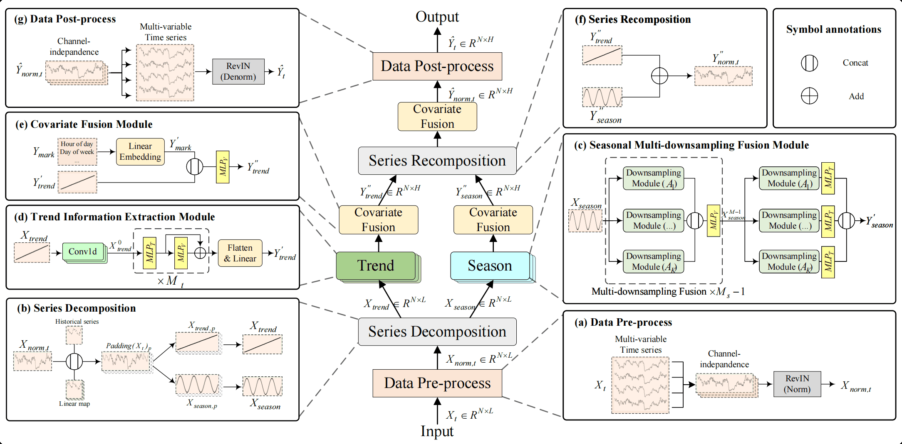
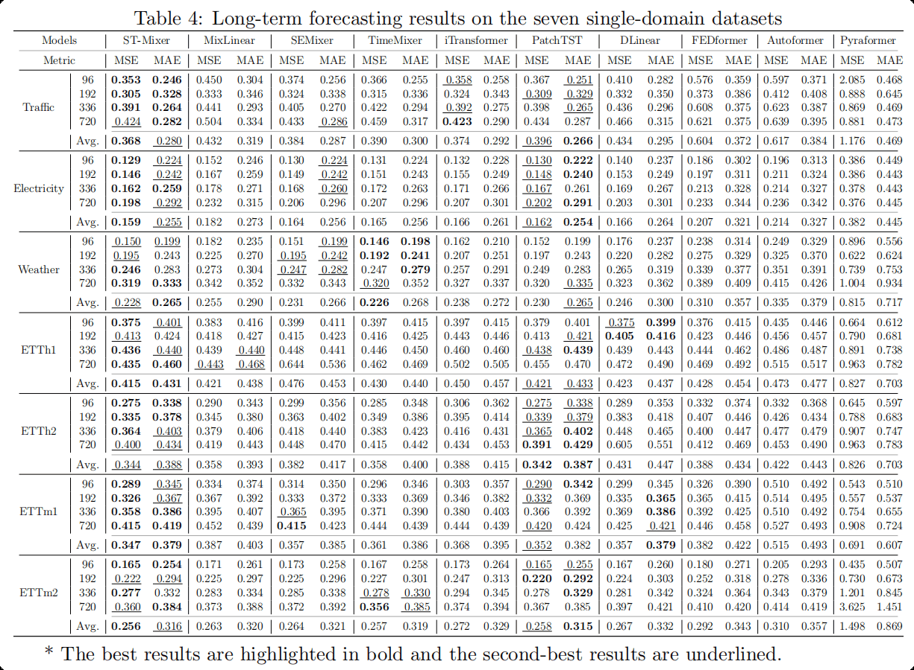
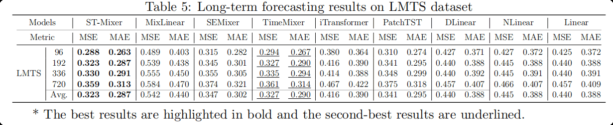

# ST-Mixer

**A Seasonality and Trend Mixing Model with Multi-downsampling Fusion Structures for Long-Term Time Series Forecasting**

ST-Mixer decomposes each series into seasonality and trend components and models them with dedicated mixing modules: a Time-series Interactive Embedding (TIE) that captures local information and a Multi-downsampling Fusion (MDF) structure that fuses global dependencies across multiple scales. The two components are combined with seasonal bottom-up and trend top-down strategies. Experiments on seven single-domain benchmarks and the large-scale cross-domain LMTS dataset show that ST-Mixer achieves state-of-the-art forecasting performance, and Nemenyi / Bonferroni-Dunn and Welch's tests confirm the improvements are statistically significant.

<p align="center">
  
</p>

#### Performance on Benchmarks   

<p align="center">

   

</p>

<p align="center"> 

  

</p>

## Environment

- Python 3.8
- PyTorch 1.7.1 (CUDA 11.1); all dependency versions in `requirements.txt` are pinned to the tested environment

```bash
pip install -r requirements.txt
```

## Datasets

**Single-domain benchmarks (7):** ETTh1, ETTh2, ETTm1, ETTm2, Electricity, Traffic, Weather. These are standard public datasets; place the CSV files under `all_six_datasets/<dataset>/` (e.g. `all_six_datasets/ETT-small/ETTh1.csv`) and run with `run.py`. Preprocessed `.npz` caches used by the loader live under `Data/` and are regenerated from the CSVs.

**Cross-domain LMTS dataset:** due to its size, the LMTS data is **not** included in this repository. Download it from the Google Drive link in the header of `Data/Data_load_7dataV3.py`, extract it under the `Data/` folder, and run with `run_all.py`.

## Repository Structure

```
├── Data/                  # data loaders (Data_load.py, Data_load_7dataV3.py)
├── Model/
│   ├── STMixer.py         # full ST-Mixer model
│   ├── ablation/          # §5.6 ablation variants
│   ├── component_swap/    # Table 7 seasonal-trend swap variants
│   ├── seasonal_variants/ # Table 8 seasonal component variants
│   ├── trend_variants/    # Table 9 trend component variants
│   └── baselines/         # 8 self-run baselines
├── layers/                # shared layers
├── exp/                   # experiment engines (Main.py, Main_basic.py, Main_for_7datasetV3.py)
├── evaluation/            # statistical test scripts (Nemenyi / Bonferroni-Dunn / Welch)
├── scripts/
│   ├── STMixer/           # ST-Mixer run scripts (per dataset / ablation / variants / all)
│   ├── baselines/         # baseline run scripts (<Model>/<dataset>.sh)
│   └── smoke_forward.py   # forward-pass smoke test for every registered model
├── run.py                 # entry point for the 7 single-domain datasets
└── run_all.py             # entry point for the LMTS cross-domain dataset
```

## Reproduction

All shell scripts assume the repo root as the working directory; adjust the conda environment name (`source activate gx`) in the first lines to your own environment.

### Main results (paper Tables 4 & 5)

ST-Mixer, seven single-domain datasets (3 seeds x 4 horizons per dataset):

```bash
bash scripts/STMixer/ETTh1/our_modelv5.sh    # one script per dataset under scripts/STMixer/<dataset>/
```

ST-Mixer on LMTS (paper Table 5):

```bash
bash scripts/STMixer/all/our_modelv5.sh      # runs run_all.py --data_set all
```

Self-run baselines (one script per dataset):

```bash
bash scripts/baselines/PatchTST/etth1.sh     # iTransformer, PatchTST, TimeMixer, SEMixer,
                                             # MixLinear, DLinear, Linear, NLinear under scripts/baselines/
```

### Ablation study (paper Table 6)

```bash
bash scripts/STMixer/ablation/traffic/STMixer_Ablation_TIE.sh       # also MDF / Scale / Padding / Covariate
bash scripts/STMixer/ablation/lmts/STMixer_Ablation_TIE.sh          # LMTS counterparts
```

### Component swap experiment (paper Table 7)

```bash
bash scripts/STMixer/component_swap/ETTh1/STMixer_Swap_TIEMDF.sh    # also TIETIE / MDFMDF / MDF / TIE
                                                                      # one folder per dataset
```

### Seasonal component variants (paper Table 8)

```bash
bash scripts/STMixer/seasonal_variants/ETTh1/STMixer_Seasonal_SCI.sh  # also MTS / BU / TD
```

> Note: the Bottom-Up (`STMixer_Seasonal_BU.sh`) and Top-Down (`STMixer_Seasonal_TD.sh`) scripts explicitly pin `--down_sampling_layers 2 --down_sampling_window 2 --down_sampling_method avg`, while the model default is 3 downsampling layers. Keep these flags as-is to reproduce Table 8.

### Trend component variants (paper Table 9)

```bash
bash scripts/STMixer/trend_variants/ETTh1/STMixer_Trend_Mean.sh      # also Linear / TD
```

### Statistical tests (paper Figures 7, 10, 11, 12 and Table 6)

After collecting the run outputs into the Excel workbooks described in each script's docstring:

```bash
python evaluation/nemenyi_all_datasets_common.py --input results/single_dataset_summary.xlsx
python evaluation/nemenyi_seven_datasets_common.py --input results/single_dataset_summary.xlsx
python evaluation/nemenyi_lmts_dataset.py --input results/single_dataset_summary.xlsx
python evaluation/nemenyi_seasonal_trend_experiment.py --input <seasonal-trend workbook>.xlsx      # Fig. 10 / Table 7
python evaluation/nemenyi_seasonal_component_experiment.py --input <seasonal-variant workbook>.xlsx # Fig. 11 / Table 8
python evaluation/nemenyi_trend_component_experiment.py --input <trend-variant workbook>.xlsx       # Fig. 12 / Table 9
python evaluation/welch_test_stmixer_patchtst_seven.py --input results/single_dataset_summary.xlsx
python evaluation/welch_test_per_config_multiseed.py --error-bar results/error_bar.xlsx
python evaluation/make_stat_test_summary_table.py --error-bar results/error_bar.xlsx
```

## Baseline Sources

> "PatchTST, DLinear, FEDformer, Autoformer and Pyraformer results are taken from the benchmark tables reported by PatchTST [19]."

Accordingly, these five baselines have **no code in this repository**; their numbers are quoted from the PatchTST benchmark tables. The eight baselines whose code and run scripts are included here (iTransformer, PatchTST, TimeMixer, SEMixer, MixLinear, DLinear, Linear, NLinear) are self-run with `run.py` / `run_all.py`. The TSMixer and MTS-Mixer entries in paper Table 1 are comparison-only and are likewise not part of this repository.

## Hyperparameters

The main hyperparameters of ST-Mixer are listed in paper Table 3. Where the typesetting of Table 3 is ambiguous, the run scripts under `scripts/STMixer/` are the ground truth (e.g. `scripts/STMixer/ETTh1/our_modelv5.sh` pins `seq_len=336, d_model(embed sizes)=8, M_s(elayer_num)=2, M_t(dlayer_num)=1, dropout=0.3`).

## Model Registry

25 models are registered in `exp/Main.py` (`MODEL_REGISTRY`) and can all be exercised with:

```bash
python scripts/smoke_forward.py --model <name>
```

| Group | Registered names |
| --- | --- |
| Full model | `STMixerv5` |
| §5.6 ablations (`Model/ablation/`) | `STMixer_Ablation_TIE`, `STMixer_Ablation_Scale`, `STMixer_Ablation_Padding`, `STMixer_Ablation_Covariate`（MDF 粒度消融直接在 `STMixerv5` 上扫 `--sampling_list`，见 `scripts/STMixer/ablation/`） |
| Table 7 swaps (`Model/component_swap/`) | `STMixer_Swap_TIEMDF`, `STMixer_Swap_MDFMDF`, `STMixer_Swap_TIETIE`, `STMixer_Swap_MDF`, `STMixer_Swap_TIE` |
| Table 8 seasonal variants (`Model/seasonal_variants/`) | `STMixer_Seasonal_SCI`, `STMixer_Seasonal_MTS`, `STMixer_Seasonal_BU`, `STMixer_Seasonal_TD` |
| Table 9 trend variants (`Model/trend_variants/`) | `STMixer_Trend_Mean`, `STMixer_Trend_Linear`, `STMixer_Trend_TD` |
| Baselines (`Model/baselines/`) | `iTransformer`, `PatchTST`, `TimeMixer`, `SEMixer`, `MixLinear`, `DLinear`, `Linear`, `NLinear` |
